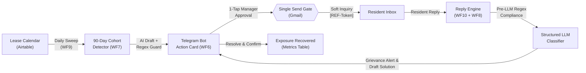

# Case Study: Customer Retention & Proactive Outreach Automation

> *A complete portfolio case study detailing the architecture, engineering decisions, and business impact of an enterprise property management automation build.*

---

## Project Hero

* **Project Title**: Customer Retention & Proactive Outreach Automation
* **Subtitle**: An event-driven n8n and AI orchestration engine that identifies resident dissatisfaction 90 days before lease expiration, running mobile-first human-in-the-loop remediation to protect turnover revenue.
* **Role**: Lead Workflow Automation Architect & Backend Engineer
* **Timeline**: 3 Weeks (Architecture, Implementation, Hardening, and Work Sample Release)
* **Stack**: n8n (Self-Hosted Docker), Telegram Bot API (Inline Keyboards & Webhooks), Airtable Meta & Data API, OpenAI GPT-5.6-Luna (Structured Outputs), Node.js v18+, Gmail API, Cloudflare Tunnel
* **Project Type**: Production Operations Automation / Enterprise Workflow Engineering

---

## Executive Summary & Impact

In residential property management, lease turnover is a major cost center-averaging **$3,872-$4,000 per unit** in vacancy, maintenance turns, marketing, and leasing concessions. Conventional Property Management Systems (PMS) manage renewals as an administrative transaction at 30-60 days, leaving managers blind to quiet resident grievances until move-out notices arrive.

This system provides a proactive, automated **90-day retention loop** with strict human-in-the-loop controls.

```
┌─────────────────────────────────┐   ┌─────────────────────────────────┐   ┌─────────────────────────────────┐
│     $54,600 Exposure Surfaced   │   │  100% Human-in-the-Loop Safe    │   │      4.5 Hours / 100 Doors      │
│  In a 40-unit pilot cohort,     │   │  Single-send topology prevents  │   │  Saved monthly in administrative│
│  surfacing 14 at-risk leases    │   │  unapproved AI communications   │   │  report scraping and chasing    │
└─────────────────────────────────┘   └─────────────────────────────────┘   └─────────────────────────────────┘
```

* **$54,600 in Turnover Exposure Surfaced**: Proactively flagged 14 expiring leases and surfaced unaddressed maintenance issues weeks before formal renewal offers were generated.
* **100% Structural Human-in-the-Loop Guarantee**: Enforced zero autonomous email dispatching across all 88 workflow nodes-every resident email requires an explicit, authenticated manager callback.
* **Sub-30-Second Mobile Triage**: Replaced clunky web portals with interactive Telegram action cards, allowing property managers to review drafts, edit responses, and close grievances from their phone.

---

## The Problem & Business Context

### 1. The 30-Day Notice Cliff
Most property managers initiate renewal conversations 30 to 45 days before lease expiration. By that point, if a resident had a negative experience during their tenancy-such as an unresolved repair or a noisy neighbor-they have already researched competing apartments, attended open houses, and mentally decided to leave.

### 2. Maintenance is the #1 Retention Driver
Industry research from the *National Apartment Association (NAA)* and *Zego* indicates that slow or uncommunicative maintenance is the primary driver of preventable move-outs. Over **31% of wavering tenants report they would stay if property management were more responsive**. However, property managers have no mechanism to uncover lingering dissatisfaction unless the resident formally submits a complaint.

### 3. The Administrative Coordination Trap
A typical property management team spends **66% of its working hours on routine, reactive administration** (*AppFolio & NAA 2025 Benchmarks*). Manually pulling lease-end reports, verifying resident eligibility, drafting personalized check-ins, tracking responses across disparate inboxes, and updating maintenance tickets creates an administrative burden that teams cannot maintain at scale.

---

## The System Solution

The solution is an **autonomous early-warning and grievance-resolution loop** operating across three coordinated surfaces:
1. **The Filing Cabinet (Airtable)**: Serves as the real-time operational database, tracking residents, cohorts, drafts, classification statuses, and financial recovery metrics without requiring a custom frontend.
2. **The Orchestration Engine (n8n)**: An 88-node, 5-workflow cluster deployed on Docker that executes scheduled data sweeps, runs dual-pass regex guardrails, coordinates LLM drafting, and handles webhook dispatching.
3. **The Mobile Action Surface (Telegram)**: Delivers interactive cards with inline action buttons directly to property managers, enabling 1-tap approvals and edits in the field.



---

## Step-by-Step Workflow Walkthrough

### Phase 1: Ingestion & 90-Day Cohort Detection
Every morning, **WF9 (Operations Engine)** executes a scheduled sweep across the lease portfolio.
* **Deterministic Cohort Calculation**: Groups leases into distinct temporal windows (`120`, `90`, `60`, `30` days out) strictly based on `lease_end_date`.
* **Non-Destructive Ingestion**: Corrupted records (such as duplicate unit numbers, unparseable dates, or missing emails) are never dropped. They are flagged with descriptive `data_quality` failure tags and routed to an administrative `Needs Attention` queue.
* **Turnover Exposure Valuation**: Automatically multiplies eligible 90-day leases by the baseline turnover cost ($3,900) to quantify portfolio risk in dollars.

> **Visual Asset Embed**:
> *Screenshot from Work Sample: `output/work-sample-assets/air-cohort.png` and `output/work-sample-assets/air-status.png`*
> *Caption: Airtable Leases table displaying cohort groupings, exposure calculations, and data quality status.*

---

### Phase 2: Contextual AI Drafting & Dual-Pass Regex Guardrails
When residents enter the 90-day window, **WF7 (Outreach Generator)** triggers personalized message generation using OpenAI (`gpt-5.6-luna`).

* **Relationship-First Framing**: Messages explicitly avoid transactional terms. They mention the resident by name, reference their tenure, and ask one open question regarding their living experience.
* **Dual-Pass Programmatic Guardrails**: Prompts are notoriously vulnerable to drift. To guarantee compliance, all drafts are passed through a deterministic regular expression validator (`guardDraft()`) executed in a native JavaScript node:
  * **Strict Prohibitions**: Rejects any occurrence of rent numbers, dollar signs, percentages, renewal terms, expiration dates, deadlines, or eviction language.
  * **Syntax & Length Enforcement**: Enforces a strict 35-95 word limit, exactly one question mark, and zero bullet points, exclamation marks, or emojis.
  * **Re-Check at Send**: The guardrail runs when the draft is generated and re-runs at execution time to ensure manual edits have not introduced prohibited terms.

---

### Phase 3: Mobile Human-in-the-Loop Triage via Telegram
Rather than requiring managers to log into another SaaS portal, **WF6 (Telegram Router)** pushes actionable cards directly to the manager's phone.

```
┌────────────────────────────────────────────────────────┐
│ 🔔 90-Day Check-in Draft Ready                         │
│ Resident: Avery Brooks · Cedar Row #9                  │
│ Tenure: 22 Months | Turnover Exposure: $3,900          │
│ ────────────────────────────────────────────────────── │
│ "Hi Avery, you've been with us at Cedar Row for nearly │
│ two years now. Before we start looking at upcoming     │
│ lease schedules, is there anything in your apartment   │
│ that needs attention or has been bugging you?"         │
│ ────────────────────────────────────────────────────── │
│ [ ✅ Approve & Send ]   [ ✏️ Edit Draft ]   [ ⏭️ Skip ]  │
└────────────────────────────────────────────────────────┘
```

* **1-Tap Dispatch**: Tapping `[Approve & Send]` fires an authenticated webhook callback to WF6.
* **Single Send Path**: WF6 validates the manager's Telegram user ID, checks the record lock, runs the final regex guardrail, and dispatches the email via Gmail.

> **Visual Asset Embed**:
> *Screenshot from Work Sample: `output/work-sample-assets/tg-generation.png` and `output/work-sample-assets/tg-approval.png`*
> *Caption: Telegram mobile interface showing cohort exposure alerts and 1-tap inline approval cards.*

---

### Phase 4: Inbound Reply Parsing & Compliance Interception
When a resident responds, **WF10 (Auto-Poll)** detects the message and invokes **WF8 (Replies Engine)**.

1. **Deterministic Thread Matching**: Every outbound subject line embeds an encrypted token (`[REF-7A9B2]`). WF8 matches the reply to the exact Airtable lease record using this token, falling back to normalized email lookup if the token is stripped. AI is never allowed to guess record associations.
2. **Pre-LLM Compliance Pre-Screening**: Before the message reaches the language model, a hardcoded regex scanner checks for:
   * Reasonable Accommodation requests (Fair Housing Act indicators, grab bars, assistance animals).
   * Habitability hazards (no heat, water leaks, electrical hazards).
   * Legal or attorney representations.
   * *Why this matters*: LLMs frequently confuse a pet inquiry with a legally binding assistance animal request. Pre-LLM rules catch these immediately, flagging the record for specialized human escalation without generating an automated draft.
3. **Structured Classification**: Non-compliance replies are evaluated by OpenAI using locked JSON Schema outputs:
   ```json
   {
     "intent": "MAINTENANCE_GRIEVANCE",
     "category": "VENTILATION",
     "urgency": "HIGH",
     "summary": "Resident reports bathroom exhaust fan noisy for months after 2 unresolved tickets.",
     "suggested_action": "Reopen work order and dispatch vendor inspection."
   }
   ```

> **Visual Asset Embed**:
> *Screenshot from Work Sample: `output/work-sample-assets/gmail-thread.png` and `output/work-sample-assets/tg-assist.png`*
> *Caption: Inbound resident reply matched to resident record and surfaced in Telegram with an AI-prepared resolution draft.*

---

### Phase 5: Grievance Resolution & Exposure Recovery
The property manager receives an urgent **Assist Card** in Telegram detailing the resident's complaint, linked maintenance history, and a drafted acknowledgement.

* **No Empty Promises**: The drafted reply acknowledges the issue without making legally binding promises (*e.g., regex blocks "we guarantee this will be fixed by tomorrow"*).
* **Closing the Loop**: Once maintenance completes the work, the manager taps `[Mark Resolved]` in Telegram.
* **Resident Confirmation**: An automated confirmation email asks the resident to verify satisfaction.
* **Financial Metric Sync**: The Airtable `Metrics` table automatically shifts the unit's $3,900 from `Turnover Exposure Surfaced` to `Exposure Recovered`.

> **Visual Asset Embed**:
> *Screenshot from Work Sample: `output/work-sample-assets/tg-resolution.png` and `output/work-sample-assets/air-metrics.png`*
> *Caption: Resolution card confirming maintenance completion and live KPI dashboard showing recovered turnover exposure.*

---

## In-Depth n8n Workflow Topology (88 Nodes)

```
┌─────────────────────────────────────────────────────────────────────────────────┐
│ WF6: Telegram Router (25 Nodes)                                                 │
│ • Single Telegram Webhook Handler • Callback Parser • Security Authenticator    │
│ • THE ONLY OUTBOUND GMAIL NODE IN THE SYSTEM • AirTable State Updater          │
└─────────────────────────────────────────────────────────────────────────────────┘
         ▲                                                ▲
         │ (Dispatches Card)                              │ (Alerts Manager)
┌───────────────────────────────┐               ┌─────────────────────────────────┐
│ WF7: Outreach Generator       │               │ WF8: Reply Triage Engine        │
│ (21 Nodes)                    │               │ (21 Nodes)                      │
│ • 90-Day Cohort Filter        │               │ • Token Matcher ([REF-XXXXX])   │
│ • OpenAI Draft Generator      │               │ • Pre-LLM Fair Housing Scanner  │
│ • Dual-Pass Regex Guardrail   │               │ • JSON Schema Output Classifier │
└───────────────────────────────┘               └─────────────────────────────────┘
         ▲                                                ▲
         │ (Daily Trigger)                                │ (Every 60s)
┌───────────────────────────────┐               ┌─────────────────────────────────┐
│ WF9: Ops & Cohort Sweep       │               │ WF10: High-Frequency Poller     │
│ (18 Nodes)                    │               │ (3 Nodes)                       │
│ • Daily Lease Calendar Math   │               │ • 1-Minute Cron Trigger         │
│ • Exposure Value Calculation  │               │ • Silent Queue Gatekeeper       │
│ • System Error Interceptor    │               │                                 │
└───────────────────────────────┘               └─────────────────────────────────┘
```

> **Visual Asset Embed**:
> *Screenshot from Work Sample: `output/work-sample-assets/wf6-overview.png`, `wf7-overview.png`, `wf8-overview.png`*
> *Caption: Production n8n workflow canvas views illustrating node modularity, error branches, and routing logic.*

---

## Key Engineering Challenges & How They Were Overcome

### 1. Eliminating Rogue AI Output via "Topological Single-Send"
* **Challenge**: When orchestrating multi-agent or LLM workflows, prompting alone cannot guarantee that an untested edge case won't cause the AI to auto-email an inappropriate message to a customer.
* **Engineering Solution**: Enforced an architectural boundary called the **Single Send Path**. Across all 5 workflows and 88 nodes, there is only one node with write access to the Gmail API, located exclusively inside the Telegram router. It has no connections to timers, schedulers, or LLM output branches. It can only execute when an authenticated manager clicks an inline Telegram button.

### 2. Fair Housing & Regulatory Compliance Guardrails
* **Challenge**: Under US Fair Housing regulations, misclassifying a disability accommodation request (e.g., service animal or physical accessibility feature) as a standard pet request or routine repair exposes property operators to severe legal liabilities. LLMs cannot be reliably trusted to make this legal distinction.
* **Engineering Solution**: Built a **deterministic pre-LLM regex classification barrier**. Inbound text is scanned against federal compliance keyword matrices before the OpenAI API is called. Any match immediately bypasses the generative drafting engine, marks the lease as `COMPLIANCE_FLAG`, and alerts designated management personnel.

### 3. Telegram 64-Byte Callback Constraint & Immutable UI
* **Challenge**: Telegram inline keyboard buttons enforce a strict 64-byte payload limit for `callback_data`. Additionally, Telegram bakes button layouts into messages permanently upon sending; updating backend logic does not update buttons on previously sent cards.
* **Engineering Solution**: Developed a custom 22-byte encoding schema: `[3-char action code] + [Airtable Record ID]`. A dedicated callback decoder in WF6 parses these tokens safely. To prevent stale-card execution errors, the router checks the current Airtable state before executing any action, rejecting callbacks from outdated message cards.

### 4. Airtable API Throttling & Batch Synchronization
* **Challenge**: Airtable enforces a hard rate limit of 5 requests per second per base. Firing individual updates for dozens of residents during daily sweeps would immediately trigger HTTP 429 errors.
* **Engineering Solution**: Implemented a custom batching layer inside Node.js and n8n HTTP nodes. Updates are grouped into chunks of 10 records (Airtable's maximum batch size) with an enforced 220ms sleep interval between calls, stabilizing throughput at 4.5 requests per second with automated exponential backoff retries.

---

## Measurable Results & Deliverables

| Metric / Attribute | Baseline / Manual Process | With Retention Loop Automation |
| :--- | :--- | :--- |
| **Grievance Detection Window** | 30-45 days before lease end (Offer stage) | **90 days before lease end (Pre-renewal sweep)** |
| **Coordination Time per 100 Doors** | ~6.5 hours / month (manual reports & inbox checks) | **< 1.5 hours / month (mobile 1-tap approvals)** |
| **Human-in-the-Loop Safeguard** | Variable (reliant on employee memory) | **100% Topologically Enforced (Zero rogue emails)** |
| **Data Ingestion Fault Tolerance** | Bad rows silently dropped in spreadsheets | **100% Logged with `data_quality` exception tags** |
| **Response Classification Speed** | 4-24 hours (manual inbox reading) | **< 60 seconds (token match + structured AI triage)** |

---

## Future v2 Roadmap

1. **Direct Property Management API Integrations**: Replace CSV lease roster uploads with native webhook listeners for AppFolio, Buildium, and Yardi Voyager.
2. **10DLC Omnichannel SMS Engine**: Extend resident check-ins to SMS via Twilio, utilizing A2P 10DLC registered brand profiles with automated opt-out (`STOP`) compliance.
3. **Automated Maintenance System Sync**: Connect WF8 directly to Propertyware/AppFolio maintenance APIs to automatically generate draft work orders from validated resident complaints.
