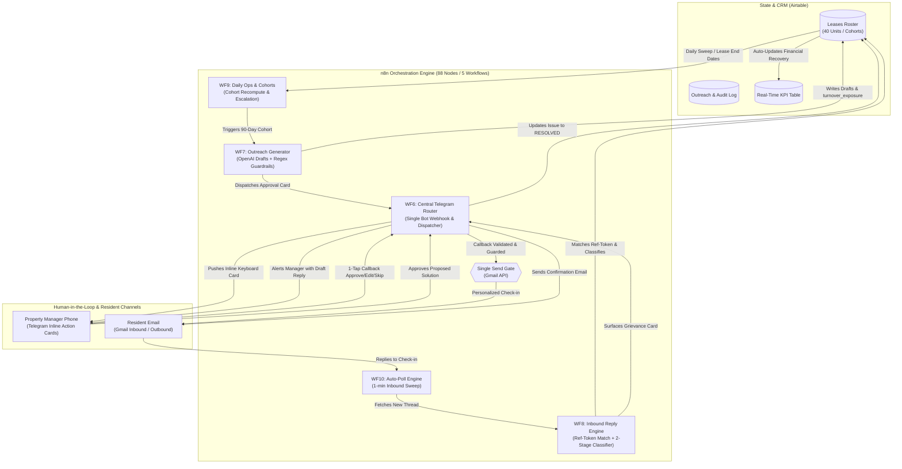

# Pre-Renewal Resident Retention & Grievance-Resolution Loop

[](https://n8n.io)
[](https://www.docker.com)
[](https://core.telegram.org/bots/api)
[](https://airtable.com)
[](https://openai.com)
[](#the-single-send-path-guarantee)

> **An event-driven property management automation that detects resident dissatisfaction 90 days before lease expiry, running AI-assisted grievance resolution with a structural human-in-the-loop guarantee.**

---

## The Operational Problem

In US residential property management (150–600+ units), **resident turnover costs an average of $3,872–$4,000 per unit** in vacancy, make-ready, marketing, and leasing concessions (*National Apartment Association*). 

Traditional property management systems (Buildium, AppFolio, Yardi) are built for **transactional lease administration**, not proactive retention:
1. **The Late 30-to-60 Day Cliff**: Managers generate renewal offers only 30–60 days before lease expiration—often paired with rent increases. By then, dissatisfied residents have already toured alternative units.
2. **Invisible Grievances**: Slow maintenance response is the #1 driver of non-renewals (*Zego Resident Experience Report*). A repair that lagged 4 weeks ago or a noisy neighbor creates quiet non-renewals that never surface in PMS reports until the move-out notice lands.
3. **Manager Cognitive Overload**: Property teams spend 66% of their week on reactive administration. Manually checking lease dates, drafting personalized check-ins, matching replies, and chasing maintenance updates across hundreds of doors is unsustainable without automation.

### The Solution
This system creates a **proactive 90-day early-warning and resolution loop**:
- Identifies residents entering the 90-day expiration window directly from lease end dates.
- Generates non-transactional relationship check-ins via OpenAI with strict regular-expression guardrails.
- Routes review cards into **Telegram** so property managers can approve, edit, or reject outreach in 1 tap from their phone.
- Classifies resident replies using two-tier triage (hard compliance regex rules first, structured JSON Schema LLM second).
- Tracks every open issue, assigns workflows, and confirms resolution before formal renewal notices go out.

---

## System Architecture



---

## Core Engineering Highlights & Defenses

### 1. The Single Send Path Guarantee
In enterprise automations involving resident communications, AI hallucinations or runaway loop schedules pose serious operational and legal risks.
* Across all **88 nodes in 5 workflows**, there is **exactly one node** capable of dispatching an email: `Gmail Send Resident Message` in `WF6`.
* WF7 (Outreach Generator) has **no send node**.
* WF9 (Ops Engine) has **no send node**.
* WF8 (Reply Engine) only contains a read node (`getAll`).
* **Architectural Guarantee**: There is zero code path connecting a schedule, timer, or LLM output directly to a resident's inbox. Every outgoing message requires an authenticated Telegram callback from a verified manager ID.

### 2. Dual-Pass Regex Guardrails
Prompts alone cannot guarantee compliance. Every draft passes through deterministic regular expression guards (`guardDraft()` and `guardReply()`) in a native JavaScript code node:
* **Strict Rejections**: Rejects any mention of rent increases, renewal terms, lease end dates, dollar figures, percentages, legal phrasing, deadlines, or eviction.
* **Format Constraints**: Enforces 35–95 word limits, resident first-name inclusion, single question mark syntax, and strict prohibition of exclamation marks, bullet points, or emojis.
* **Anti-Promise Protection**: Inbound reply drafts reject commitments like *"we will fix"*, *"guaranteed"*, *"by Friday"*, or *"within 24 hours"*.
* **Two-Run Validation**: Guardrails execute twice—once when OpenAI drafts the copy, and again at execution time right before transmission.

### 3. Two-Tier Classification (Pre-LLM Compliance Filtering)
Incoming resident emails are processed through a two-stage filter:
1. **Deterministic Regex Screening (Pre-LLM)**: Before consulting the language model, messages are scanned for Fair Housing indicators, accommodation requests (e.g., grab bars, service animals), habitability hazards, or legal threats. Language models struggle to distinguish ordinary pet questions from assistance animal accommodations; deterministic rules catch these instantly and route them to compliance personnel without automated response drafts.
2. **Structured JSON Schema Classification**: For general inquiries, OpenAI (`gpt-5.6-luna`) classifies under a locked schema (`intent`, `grievance_category`, `urgency`, `suggested_human_action`, `confidence`). No unconstrained free text is permitted.

### 4. Deterministic Subject-Token Matching
The system never uses AI to "guess" which resident replied. Outbound messages carry an encoded reference token in the subject line (`[REF-XXXXX]`). When a reply arrives, `WF8` isolates the token and maps it directly to the Airtable record ID. If missing, it falls back to normalized sender email matching. If both fail, an unmatched alert is dispatched without altering resident state.

### 5. API Rate-Limit & Payload Budgeting
* **Airtable Meta & Data API**: Airtable imposes a strict 5 req/sec limit. All writes are batched in 10-record arrays with a deliberate 220ms sleep interval (~4.5 req/sec).
* **Telegram 64-Byte Callback Limit**: Telegram inline keyboard `callback_data` cannot exceed 64 bytes. Actions use 3-character action codes plus the Airtable record ID (total 22 bytes), guaranteeing reliability.

### 6. Resilient Data Ingestion
Dirty PMS lease exports (duplicate unit numbers, unparseable dates, missing emails) are never dropped. The ingest engine flags corrupted rows with explicit `data_quality` failure tags and displays them in a dedicated `Needs Attention` view, ensuring no resident is silently lost.

---

## Workflow Architecture (88 Nodes / 5 Workflows)

| Workflow | File | Nodes | Primary Responsibilities |
| :--- | :--- | :---: | :--- |
| **WF6: Telegram Router** | `n8n-workflows/wf6-telegram-router.json` | 25 | Owns Telegram webhook; dispatches callbacks; manages approval state; **hosts the only outbound Gmail node**. |
| **WF7: Outreach Generator** | `n8n-workflows/wf7-outreach.json` | 21 | Queries 90-day cohort; invokes OpenAI drafting; applies `guardDraft()`; posts summary and approval cards. |
| **WF8: Inbound Replies** | `n8n-workflows/wf8-replies.json` | 21 | Ingests new emails; executes token matching; runs pre-LLM compliance regex; executes structured classification; notifies manager. |
| **WF9: Operations & Metrics** | `n8n-workflows/wf9-ops.json` | 18 | Daily cohort recomputation; calculates turnover exposure ($4,000 baseline); manages escalation triggers and system error handlers. |
| **WF10: Auto-Check Poller** | `n8n-workflows/wf10-auto-check.json` | 3 | High-frequency poller calling WF8 every 60 seconds; remains silent when queue is empty. |

---

## Tech Stack

* **Workflow Orchestration**: [n8n](https://n8n.io) (Self-hosted inside Docker)
* **Manager Action Surface**: [Telegram Bot API](https://core.telegram.org/bots/api) (Inline Keyboards & Callback Queries)
* **Database & CRM**: [Airtable Meta API & Data API](https://airtable.com)
* **Intelligence & Guardrails**: [OpenAI Responses API](https://platform.openai.com) + Custom JavaScript Regex Guards
* **Messaging Channel**: Gmail API
* **Local Tunneling**: Cloudflare Tunnel (`cloudflared`) for secure webhook delivery

---

## Local Environment & 1-Command Setup

The entire stack is containerized and comes with an automated initialization suite.

### Prerequisites
* Docker & Docker Compose
* Node.js v18+ (uses native `fetch` and built-in standard modules)

### Quickstart

1. **Clone the repository:**
   ```bash
   git clone https://github.com/SambhavJain26/renewal-retention.git
   cd renewal-retention
   ```

2. **Configure Environment:**
   ```bash
   cp .env.example .env
   ```
   Generate an n8n encryption key:
   ```powershell
   # PowerShell
   [guid]::NewGuid().ToString('N') + [guid]::NewGuid().ToString('N')
   ```
   Add your Airtable PAT, Base ID, and Telegram Chat ID to `.env`.

3. **Start n8n Container:**
   ```bash
   docker compose up -d n8n
   ```

4. **Initialize Airtable Schema:**
   Creates the `Leases`, `Outreach Log`, `Config`, and `Metrics` tables with color-coded select options:
   ```bash
   node scripts/v2/setup-airtable-schema.js
   ```

5. **Seed Demo Data & Run Health Check:**
   Loads 40 sample residents (with 14 in the 90-day window and 8 dirty data exceptions):
   ```bash
   node scripts/v2/seed-airtable-demo.js
   ```

6. **Start the Demo Suite:**
   Checks container health, verifies active workflows, checks public tunnel status, and generates the initial 90-day check-in batch:
   ```bash
   node scripts/v2/demo-start.js
   ```
   *Within 30 seconds, Telegram will receive the cohort exposure card and your first resident approval cards.*

---

## Project Structure

```
renewal-retention/
├── .env.example                     # Environment template with dummy variables
├── docker-compose.yml               # Production n8n container definition
├── n8n-workflows/                   # Sanitized n8n workflow export definitions
│   ├── wf6-telegram-router.json     # Webhook router & single send gate
│   ├── wf7-outreach.json            # AI drafting & guardrails
│   ├── wf8-replies.json             # Classification & triage engine
│   ├── wf9-ops.json                 # Daily cohort sweep & metrics calculation
│   └── wf10-auto-check.json         # Inbound reply poller
├── scripts/
│   ├── v2/
│   │   ├── demo-start.js            # Turnkey 1-command startup & diagnostic tool
│   │   ├── setup-airtable-schema.js # Programmatic Airtable schema generation
│   │   ├── seed-airtable-demo.js    # Data seeding engine with date re-anchoring
│   │   ├── airtable-lib.js          # Rate-limited Airtable API client
│   │   └── workflow-common.js       # Shared node factories & sanitizers
├── output/
│   └── work-sample-assets/          # UI screenshots & workflow architecture captures
├── docs/                            # In-depth architectural & operating specifications
│   ├── build-technical-notes.md     # Deep-dive technical decisions & node constraints
│   ├── how-the-system-works.md      # Business & operations breakdown
│   ├── operating-guide.md           # Step-by-step presentation script
│   └── v2-airtable-setup.md         # Schema & field setup guide
└── CASE_STUDY.md                    # Ready-to-publish portfolio case study
```

---

## Technical Trade-offs & Design Decisions

| Decision | Selected Approach | Alternative Rejected | Rationale |
| :--- | :--- | :--- | :--- |
| **Orchestration** | Self-hosted n8n (Docker) | Make.com / Zapier | Client owns full data sovereignty and workflow definitions; zero per-step execution markups; portable via standard JSON exports. |
| **Action Surface** | Telegram Bot API | Custom Web App Dashboard | Property managers work in the field. Inline mobile cards eliminate portal fatigue and achieve sub-minute response times without maintaining frontend code. |
| **State Storage** | Airtable Meta/Data API | PostgreSQL + Prisma | Airtable acts simultaneously as the relational database and the manager's live visual table, eliminating the need to build a custom internal portal. |
| **Safety Enforcement**| Programmatic Regex Code Nodes | Prompt Engineering Alone | LLM system prompts can be bypassed or degraded. Code-level regular expressions guarantee mathematical enforcement of Fair Housing and pricing bans. |
| **Resident Channel**| Gmail Threading with Token ID | SMS / WhatsApp | Lease rosters universally contain email addresses. Subject-token encoding provides 100% deterministic thread matching without SMS carrier registration (A2P 10DLC). |

---

## License & Security
Private Client Build — Proprietary Intellectual Property. All credentials, API tokens, and resident identities in this repository are sanitized mock data.
